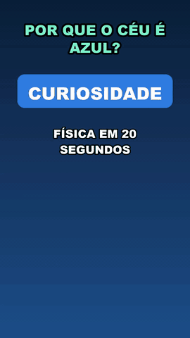
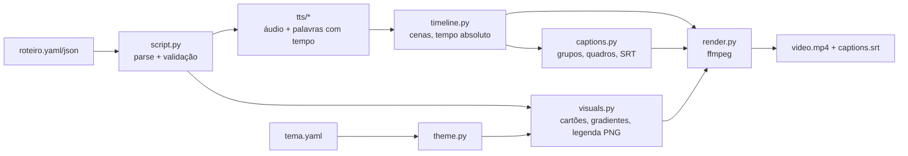

# shorts-pipeline

> Script (YAML/JSON) in, vertical short out: TTS narration, word-by-word synced captions, configurable visual identity. Pluggable TTS, tested timeline.



Demo real, gerada por este repositório com o roteiro de [`examples/roteiro.yaml`](examples/roteiro.yaml): [`examples/demo/demo.mp4`](examples/demo/demo.mp4) (28 s, 1080x1920, 2 MB, voz Edge TTS).

## Problema

Produzir vídeos curtos verticais em série (Shorts, Reels, TikTok) costuma ser trabalho manual em editor: gravar voz, cortar cenas, cronometrar legenda. Este projeto transforma isso em uma etapa de build: um arquivo de roteiro descreve o que é dito e o que aparece na tela; a ferramenta cuida de narração, duração das cenas, legenda sincronizada e codificação.

Nasceu como um script único (`render.py`) de um projeto pessoal de canal de vídeos. Aqui foi generalizado: roteiro declarativo, tema configurável, TTS plugável, núcleo de temporização separado do I/O e coberto por testes.

## Como rodar

Requisitos: Python 3.9+, `ffmpeg` e `ffprobe` no PATH.

```bash
python -m venv .venv && source .venv/bin/activate
pip install -e ".[dev]"

python -m shorts validate examples/roteiro.yaml     # valida roteiro + tema
python -m shorts plan examples/roteiro.yaml         # timeline estimada, offline, sem renderizar
python -m shorts render examples/roteiro.yaml       # gera out/ceu-azul/video.mp4 + captions.srt
```

Opções de `render`: `--tts edge|say|mock|pacote.modulo:Classe`, `--voice`, `--rate "+10%"`, `--theme tema.yaml`, `--out DIR`, `--max-mb N`, `--keep-tmp`.

### Formato do roteiro

```yaml
id: meu-video
title: Texto fixo no topo          # opcional
tts: edge                           # edge | say | mock | modulo:Classe
voice: pt-BR-AntonioNeural          # específica do provedor
rate: "+8%"
theme: tema.yaml                    # caminho ou mapa inline
scenes:
  - text: "Fala da cena."
    visual: {type: color, colors: ["#0B1F3A", "#2F7DE1"]}
  - text: "..."
    visual: {type: image, file: foto.jpg}            # Ken Burns leve
  - text: "..."
    visual: {type: video, file: clipe.mp4}           # em loop até acabar a fala
  - text: "..."
    visual: {type: card, style: step|alert|number|signature, label: "...", lines: ["..."]}
  - text: "..."
    visual: {type: pexels, query: "ocean"}           # opcional, exige PEXELS_API_KEY
```

JSON com a mesma estrutura também é aceito. Caminhos são relativos ao arquivo do roteiro. Cenas `pexels` sem chave (ou sem resultado) caem para gradiente.

### Identidade visual

Um arquivo de tema ([`examples/tema.yaml`](examples/tema.yaml)) define cores, gradientes, fontes, `handle`, avatar e o estilo de legenda (`caption.mode`: `word` ou `group`, tamanho, posição, contorno, máximo de palavras por bloco). Campos omitidos usam o padrão; campos desconhecidos ou cores inválidas falham na validação com mensagem apontando o campo.

### TTS plugável

| Provedor | Custo | Rede | Tempo por palavra |
|---|---|---|---|
| `edge` (padrão) | grátis, sem chave | precisa de internet | real (WordBoundary) |
| `say` | grátis | offline (somente macOS) | estimado |
| `mock` | grátis | offline, qualquer SO | estimado (áudio mudo) |

Provedor próprio: implemente `synthesize(text, dest, voice, rate) -> list[Word]` (grave o áudio em `dest` e devolva palavras com `start`/`end` em segundos) e use `--tts meu_pacote.modulo:MinhaClasse` ou `shorts.tts.register("nome", Classe)`.

O padrão é `edge` porque era o que o projeto original usava: gratuito e é o único que entrega tempos reais por palavra. Ele depende de rede; para rodar totalmente offline use `--tts say` ou `--tts mock`.

## Arquitetura



- **Núcleo puro** (`script`, `theme`, `captions`, `timeline`): sem I/O, sem ffmpeg. Recebe durações e palavras com tempo, devolve cenas e quadros de legenda. É onde os testes atuam.
- **Borda** (`tts/`, `visuals`, `render`, `media`): TTS, Pillow e ffmpeg.
- **Renderização**: cada cena vira um clipe (imagem com zoom lento, vídeo em loop ou cartão); as vozes são concatenadas com `apad` para casar com a duração da cena; a legenda é uma sequência de PNGs transparentes concatenada em `.mov` com alfa e sobreposta; o bitrate de vídeo é calculado para respeitar `--max-mb`.

## Decisões de design

- **Legenda por palavra.** O grupo curto (até 3 palavras / 16 caracteres) fica na tela e a palavra falada muda de cor. Em vídeo vertical a atenção está na legenda; texto longo e estático obriga a ler à frente da voz, enquanto o destaque ancora o olhar no que está sendo dito e mantém a retenção. O modo `group` (bloco fixo) continua disponível. O SRT exportado é por grupo, porque players não animam destaque por palavra.
- **Pausas pela pontuação.** O Edge TTS devolve as palavras sem pontuação; `mark_pauses` recupera do texto original onde a frase pausa, e os grupos são quebrados ali, evitando legenda que atravessa o fim de uma frase.
- **Legenda mantida por no máximo `max_hold` (0,35 s)** depois da última palavra, para não ficar na tela durante uma pausa longa.
- **Timeline separada do renderizador.** Duração de cena = duração real do áudio + 150 ms de respiro. Como a timeline é uma função pura, ela é testável sem gerar vídeo e o comando `plan` reaproveita a mesma lógica com tempos estimados.
- **Estimativa de tempo por palavra** (provedores sem WordBoundary): divide a duração do áudio proporcionalmente ao tamanho da palavra, com peso extra para pontuação. Simples e determinístico; ver limitações.
- **PNG + concat em vez de `drawtext`.** Pillow dá controle total (contorno, quebra de linha, cor por palavra) sem depender de fontes/filtros do ffmpeg, ao custo de um `.mov` intermediário maior.
- **Fonte com fallback.** Usa a do tema; senão a primeira disponível (Arial Black no macOS, DejaVu no Linux, Arial no Windows); senão a embutida do Pillow.

## Testes

```bash
pytest
```

52 testes passando (parsing e validação de roteiro/tema, timing de legendas, agrupamento, SRT, montagem da timeline, registro de provedores e CLI). Nenhum renderiza vídeo nem usa rede; rodam em ~0,1 s.

## Números medidos

Roteiro de exemplo (5 cenas, 28,1 s de vídeo), provedor `edge`, em um MacBook Apple Silicon: render completo em cerca de 21 s; saída com `--max-mb 3.5` ficou em 1,99 MB. Medição única, não é benchmark.

## Limitações

- Tempos de `say`/`mock` são estimados: a palavra destacada pode ficar alguns décimos de segundo fora da fala real.
- `edge` depende de serviço online não oficial; pode mudar ou falhar sem aviso. Não há retry.
- Layout de cartões e legenda é fixo em 1080x1920; fontes sem os glifos usados (acentos) podem renderizar mal.
- Sem música de fundo, transições entre cenas ou mistura de áudio.
- Renderização de legenda gera um PNG por palavra: roteiros de vários minutos geram milhares de quadros e ficam lentos.
- Testes não cobrem a etapa do ffmpeg; ela foi validada manualmente com a demo.

## Próximos passos

Provedor de TTS local com alinhamento forçado (tempos reais offline), música de fundo com ducking, transições, resolução configurável e teste de integração com `mock` em CI.

## Licença

MIT, Jhuan Montoya.
